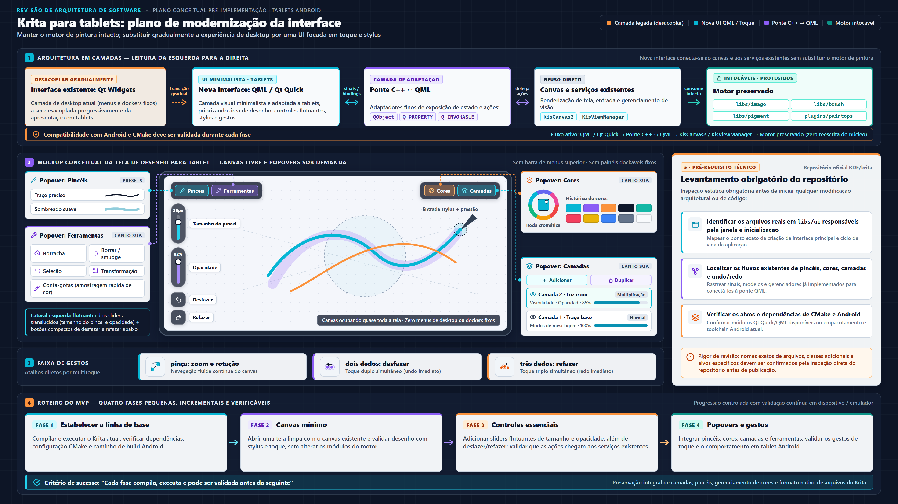
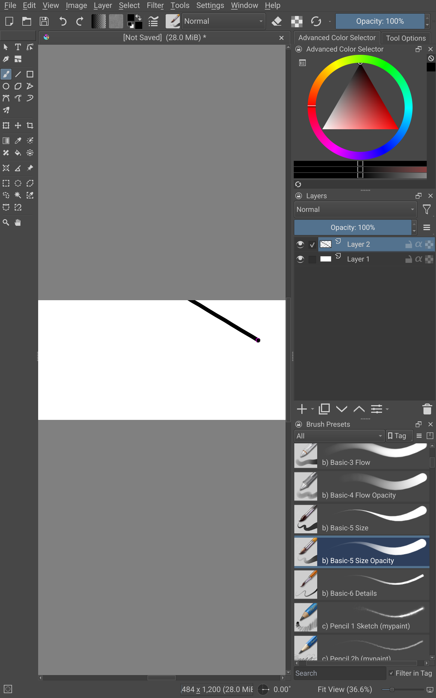
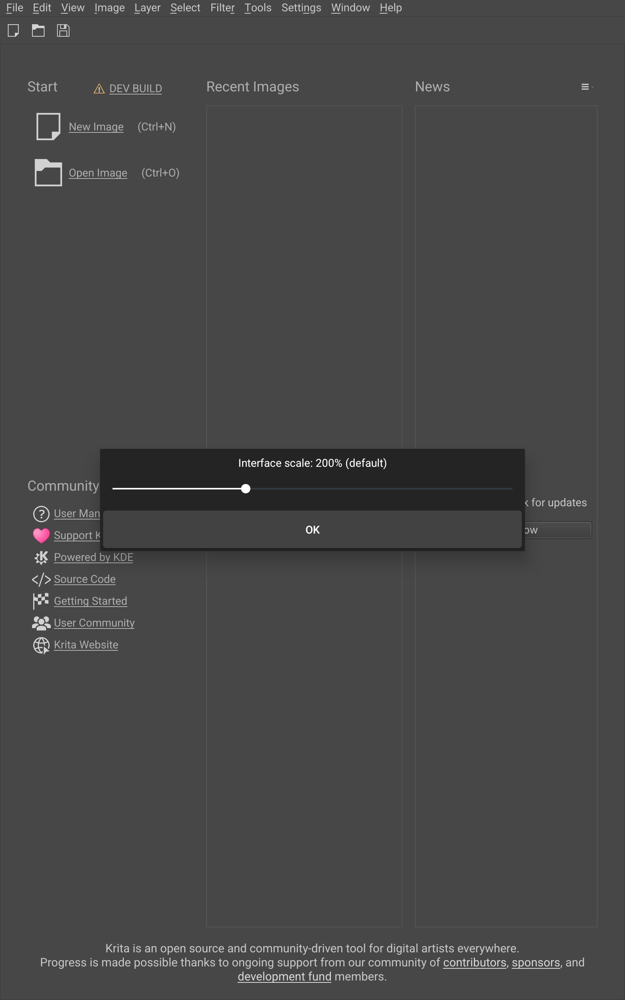

# Krita para Tablets Android — Plano e Implementação de UI Moderna (QML / Qt Quick)

Modernização gradual da interface do **Krita** voltada para tablets Android (inspirada na ergonomia minimalista do Procreate e ibisPaint X), **preservando 100% do motor C++ de pintura, camadas, pincéis, gerenciamento de cores e formato nativo `.kra`**.

---

## Diretriz Arquitetural

- **Motor Intocável (Zero Reescrita):** `libs/image`, `libs/brush`, `libs/pigment` e `plugins/paintops` permanecem integralmente preservados (baseado no código oficial [`KDE/krita`](https://github.com/KDE/krita) em `e6de546`).
- **Desacoplamento Progressivo da Camada Visual:** substituição gradual da experiência desktop baseada em `Qt Widgets` (barra de menus superior e painéis dockáveis fixos) por controles flutuantes translúcidos e popovers sob demanda em **QML / Qt Quick**.
- **Ponte C++ ↔ QML Enxuta:** adaptadores `QObject` (`Q_PROPERTY` / `Q_INVOKABLE`) conectados diretamente a `KisCanvas2`, `KisViewManager`, `KisCanvasResourceProvider`, `KisNodeModel` e `KisNodeManager`, respeitando a hierarquia de superfícies nativas OpenGL (`KisOpenGLCanvas2`).

---

## Roteiro do MVP

- [x] **Fase 1 — Estabelecer a linha de base:** configurar ambiente Android (`SDK 36` + `NDK 27.3.13750724` + `CMake 3.31` + `Qt 5.15` patcheado via `krita-deps-management`), compilar o APK oficial sem modificações e validar execução e pintura em tablet Android (`x86_64`).
- [ ] **Fase 2 — Canvas mínimo:** abrir tela limpa em modo tela cheia com `KisCanvas2` / `KisOpenGLCanvas2`, ocultando menus e dockers de desktop por padrão no Android e validando desenho com stylus e toque.
- [ ] **Fase 3 — Controles essenciais:** adicionar sliders flutuantes translúcidos na lateral para **tamanho do pincel** e **opacidade**, além de botões compactos de **desfazer** e **refazer**.
- [ ] **Fase 4 — Popovers e gestos:** integrar popovers nos cantos superiores (**Pincéis**, **Cores**, **Camadas** e **Ferramentas**) e validar gestos nativos de multitoque (pinça para zoom/rotação, 2 dedos para desfazer, 3 dedos para refazer).

---

## Evidências da Fase 1 (Linha de Base Validada em Android)

| Canvas aberto com traço de pincel validado (`UI Desktop Base`) | Tela inicial carregada (`Escala 200% Android`) |
|---|---|
|  |  |

---

## Estrutura do Repositório

- [`krita/`](./krita) — Código-fonte do Krita (base `5.4.0-prealpha` @ `e6de546`), onde as adaptações em `libs/ui` e `qmlmodules` são aplicadas incrementalmente.
- [`docs/PLANO_IMPLEMENTACAO.md`](./docs/PLANO_IMPLEMENTACAO.md) — Mapeamento técnico completo dos arquivos reais (`libs/ui`, `qmlmodules`, `packaging/android`), requisitos de build e arquitetura da ponte C++ ↔ QML.
- [`scripts/android-wsl2/`](./scripts/android-wsl2) — Scripts automatizados para provisionar o ambiente WSL2 Ubuntu 22.04, baixar dependências pré-compiladas do KDE e gerar o `.apk`.
- [`krita-arquitetura-tablets-infografico.pdf`](./krita-arquitetura-tablets-infografico.pdf) / [`.html`](./krita-arquitetura-tablets-infografico.html) — Lâmina vetorial e matriz HTML/SVG do infográfico de revisão de arquitetura.

---

## Licença

Assim como o projeto upstream [KDE Krita](https://invent.kde.org/graphics/krita), o código-fonte deste repositório é distribuído sob a licença **GNU General Public License v3.0 (GPL-3.0-or-later)** — consulte [`krita/COPYING`](./krita/COPYING).
